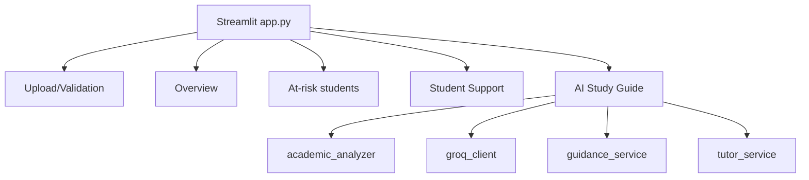

# Project Architecture

Modules:
- app.py: navigation and routing
- ai_study_guide/academic_analyzer.py: de-identified analysis
- ai_study_guide/groq_client.py: Groq API wrapper
- ai_study_guide/guidance_service.py: structured guidance
- ai_study_guide/study_guide_view.py: UI
- ai_study_guide/tutor_service.py: tutor chat
